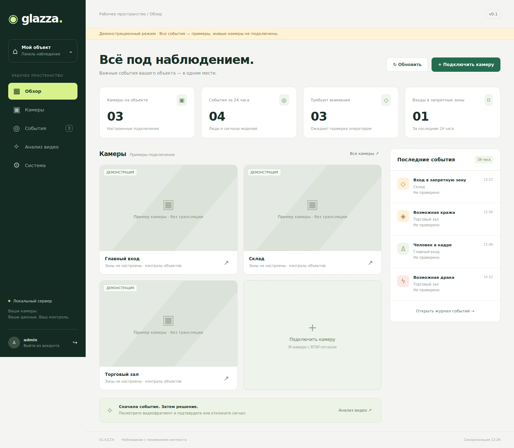
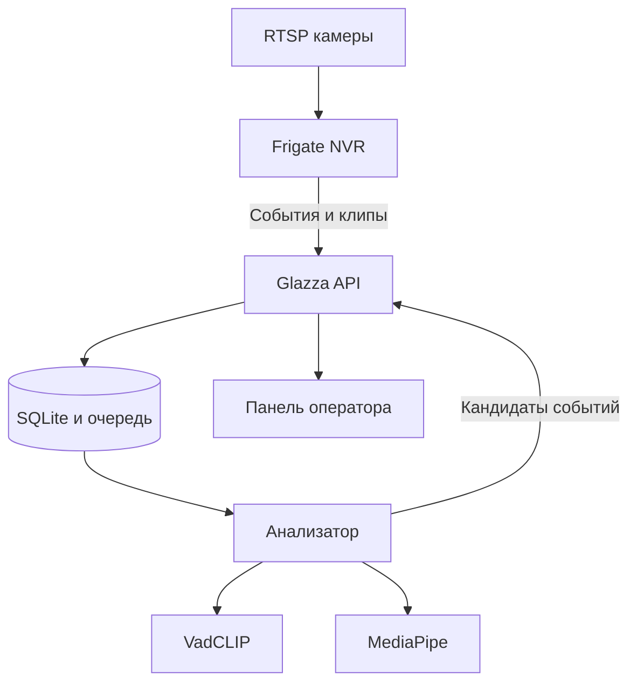

# Glazza

**Локальное видеонаблюдение: камеры, запретные зоны и проверка событий в одном интерфейсе.**

Glazza объединяет Frigate NVR 0.18.2, собственную панель оператора, очередь анализа видео и адаптеры обученных моделей. Видео обрабатывается на вашем сервере. Подписки и внешние AI API не нужны.

**Статус: первая версия для пилота.** Панель и API проверены локально. Для приёмки на объекте нужны реальные камеры, нагрузочное испытание и размеченные записи. Детекторы драки и кражи нельзя считать работающими, пока в разделе «Анализ видео» VadCLIP не показывает «Модель загружена». Веса VadCLIP не входят в репозиторий.



## Возможности и границы

| Функция | Реализация | Условие работы |
|---|---|---|
| Камеры и архив | Frigate, RTSP, запись, снимки и клипы | Подключённая камера и запущенный профиль `nvr` |
| Панель камер | Последние кадры обновляются каждые 2 секунды | Это просмотр кадров, не WebRTC-трансляция; полный NVR доступен отдельно |
| Проникновение | Человек входит в нарисованную запретную зону | Зона отмечена и конфигурация применена; опрос каждые 5 секунд |
| Драки / возможные кражи | Адаптер VadCLIP, 14 классов UCF-Crime | Официальный checkpoint, профиль `ai`; анализ после завершения события |
| Мимика | MediaPipe Face Landmarker: 52 коэффициента | Официальная модель, профиль `ai`; лицо должно быть различимо |
| Проверка оператором | Видео, подтверждение / отклонение, комментарий, аудит | Работает в панели |
| Собственные видео | MP4/MOV, до 200 МБ и 120 секунд | Анализатор и хотя бы одна загруженная модель |
| Сохранность | SQLite WAL, очередь с повторами, резервное копирование | Один экземпляр API / один worker |

Классы модели — сигналы для проверки. Они не доказывают кражу. Мимика не используется для вывода о намерениях, характере или личности человека.

## Быстрый запуск

Linux x86-64, Python 3.10+ для установщика, Git, Docker Engine и Docker Compose v2. Используйте обычного пользователя с доступом к Docker. Для пилота начните с одной камеры; поддерживаемая нагрузка в этой версии не измерена.

```bash
git clone https://github.com/adilusrr-gif/Glazza.git
cd Glazza
python3 scripts/setup.py
docker compose --profile nvr up -d --build
```

Откройте **http://localhost:8080**. Логин и сгенерированный пароль находятся в `credentials.txt`. Файлы `.env`, пароли, видео и модели не отслеживаются Git.

Если сервер удалён:

```bash
ssh -L 8080:127.0.0.1:8080 user@server
```

1. В панели нажмите **«Подключить камеру»**, укажите название, идентификатор латиницей и RTSP-адрес.
2. Нажмите **«Применить настройки»**. Frigate перезапустится.
3. Откройте карточку камеры, нарисуйте зону, задайте её имя, нажмите **«Добавить зону»**, затем **«Сохранить зоны»**.
4. Ещё раз примените настройки. Вход человека в зону создаст событие для проверки.

Frigate UI: **https://localhost:8971** (его собственная авторизация). Первичный пароль Frigate смотрите в `docker compose --profile nvr logs frigate`. Внутренний порт 5000 наружу не публикуется.

## Включить анализ мимики

```bash
python3 scripts/models.py face
docker compose --profile nvr --profile ai up -d --build
```

Модель скачивается из официального хранилища Google и проверяется по фиксированному SHA-256. После установки анализ работает без внешней сети. В панели «Анализ видео» должен появиться статус готовности MediaPipe. Если VadCLIP не установлен, система прямо сообщает, что драка и кража не проверялись.

## Подключить VadCLIP

Официальный UCF-Crime checkpoint распространяется авторами отдельно: [README VadCLIP, строка UCF-Crime / Model](https://github.com/nwpu-zxr/VadCLIP#training). На 23.10.2026 загрузка по ссылке OneDrive из среды сборки вернула HTTP 403. Автоматическую установку недоступных весов Glazza не имитирует.

Получив официальный `.pth` файл:

```bash
python3 scripts/models.py vadclip --checkpoint /absolute/path/to/model_ucf.pth
docker compose --profile nvr --profile ai up -d --build
docker compose --profile ai restart analyzer
```

Установщик фиксирует исходники на конкретном commit, применяет две совместимые правки, сохраняет контрольные суммы. Загрузка весов — `torch.load(weights_only=True)`, сопоставление параметров строгое. [Подробности моделей и ограничения](docs/MODELS.md).

Для GPU анализатора, если установлен NVIDIA Container Toolkit:

```bash
docker compose -f compose.yaml -f compose.gpu.yaml --profile nvr --profile ai up -d --build
```

Этот профиль ускоряет анализатор, **не** детектор объектов Frigate. Его аппаратное ускорение настраивается отдельно. Базовый CPU-детектор Frigate предназначен для начала пилота; производительность на нескольких камерах не обещается.

## Демонстрация без камер

В отдельной копии проекта:

```bash
python3 scripts/setup.py --demo
docker compose up -d --build
```

Есть явно помеченные демонстрационные события, но нет поддельных видеопотоков. Данные демонстрации хранятся в `data-demo/`. Приложение отказывается смешивать рабочую и демонстрационную БД.

## Проверки и обслуживание

```bash
python3 -m pip install -r requirements-dev.txt
python3 -m pytest -q
node --check app/static/app.js
python3 scripts/backup.py --data data
docker compose --profile nvr --profile ai logs --tail=100
```

- [Развёртывание, восстановление, ограничения](docs/OPERATIONS.md)
- [Модели и источники](docs/MODELS.md)
- [Фактически выполненные проверки](docs/VALIDATION.md)
- [Сторонние компоненты и лицензии](THIRD_PARTY.md)

## Архитектура



API: FastAPI, SQLite, httpx. Интерфейс: HTML/CSS/JavaScript без CDN и сборки Node. Анализ: PyTorch, MediaPipe, FFmpeg. Docker Compose разделяет NVR, API и анализатор. Это развёртывание для одного объекта и одного оператора; мультитенантность, роли и высокая доступность в версии 0.1 не реализованы.
