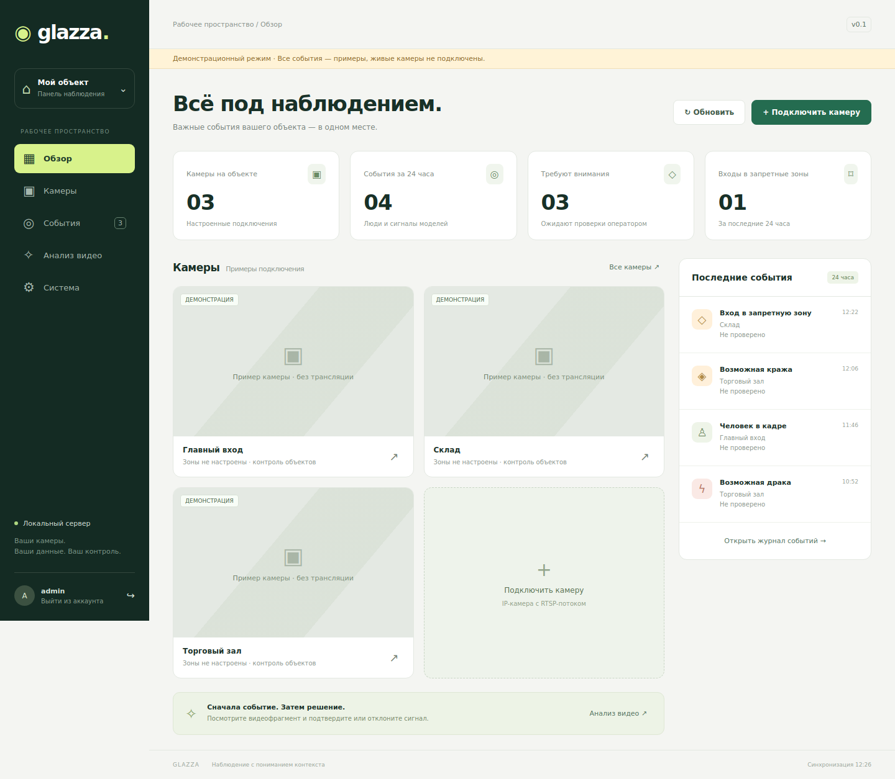
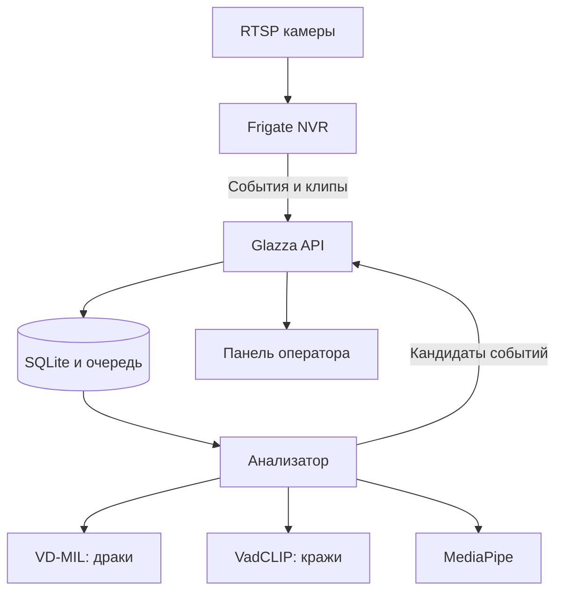

# Glazza

Фирменная эмблема: [Glazza — PNG на прозрачном фоне](app/static/brand/glazza-logo.png).

**Универсальная локальная видеоаналитика: организации, объекты, камеры и профили для образования, ресторанов, магазинов, складов, офисов и территорий.**

Glazza объединяет Frigate NVR 0.18.2, собственную панель оператора, очередь анализа видео и адаптеры обученных моделей. Видео обрабатывается на вашем сервере. Подписки и внешние AI API не нужны.

**Статус: первая версия для пилота.** Панель и API проверены локально. Для приёмки на объекте нужны реальные камеры, нагрузочное испытание и размеченные записи. Для драк подключён отдельный обученный VD-MIL с доступным установщиком весов. Он проверен на двух публичных демонстрационных сценах и статичном контрольном видео; это не оценка точности для колледжа. Для магазина доступна проверка маршрута от полки до выхода по данным Frigate. Дополнительный анализ поведения требует отдельного checkpoint VadCLIP. Веса не входят в Git.



## Организации, объекты и профили

Раздел **«Объекты»** позволяет создать организацию и филиалы, выбрать отраслевой профиль, включить реализованные модули и распределить камеры. Верхний переключатель фильтрует обзор, карту, журнал, загрузку видео и допуск. История сохраняет объект на момент события.

Это единая установка для доверенного администратора, **не SaaS с изоляцией независимых клиентов**. Очереди, СИЗ, сокрытие товара, автомобильная аналитика и кассовые интеграции пока запланированы и не могут быть включены. [Архитектура и настройка объектов](docs/PLATFORM.md).

## Контроль потерь в магазине

У магазина может быть несколько входов. Когда камера любого настроенного входа фиксирует проход внутрь, Glazza выдаёт временный ID визита в этом магазине. В карточке видны вход, последнее наблюдение и история переходов между камерами. Для проверки пути от полки через кассу к выходу можно связать три разных ракурса. [Настройка входа и связей камер](docs/RETAIL.md#визиты-и-связи-между-камерами).

Оператор получает видео и время для проверки в двух случаях. Frigate проследил человека от полки до выхода без зарегистрированного посещения кассовой зоны, либо дополнительная модель выделила подозрительный фрагмент. Маршрут можно настроить на одной камере или на трёх отдельных камерах. Для обоих вариантов достаточно детекции людей в Frigate. Обычный уход без покупки также может дать сигнал. Для решения о внедрении оценивают пропущенные эпизоды и лишние карточки на камеру-час. [Запуск на одной камере и работа смены](docs/RETAIL.md) · [Измерение качества](docs/THEFT_EVALUATION.md).

## Контроль допуска без турникетов

Добавлен раздел **«Допуск»**: реестр студентов/сотрудников и временных гостей, фотографии, сроки действия, камеры входа/выхода, локальное сопоставление YuNet + SFace и решения охраны. Неопознанные посетители остаются на проверке. Автоматического открытия двери или обвинения в нарушении нет.

Установка модели: `python3 scripts/models.py identity`, затем пересоберите и перезапустите профиль `ai`. [Настройка, данные и ограничения](docs/ADMISSION.md).

## Столы и обслуживание в ресторане

Раздел **«Ресторан»** показывает столы на кадре камеры и в карточках: зелёный — готов к посадке, красный — гости ожидают официанта или обслуживаются, жёлтый — требуется уборка, серый — нет актуальных данных. Посадка создаёт адресное уведомление официанту; если подход не подтверждён за **120 секунд**, уведомление получает менеджер. После устойчивого отсутствия гостей создаётся задача на уборку.

Подход официанта и готовность стола подтверждаются сотрудником. Есть кнопка **«Гости отошли»**, персональные экраны официанта/менеджера/уборки и необязательная доставка в Telegram. Таймеры и задачи сохраняются при перезапуске и работают без открытого браузера. Текущую занятость передаёт Frigate через внутренний MQTT; дополнительные веса моделей для этого модуля не нужны.

[Включение, разметка столов, уведомления и ограничения](docs/RESTAURANT.md).

## Возможности и границы

Поддерживаются RTSP/RTSPS, HTTP(S) MJPEG/HLS/FLV и RTMP(S), загрузка
MP4/MOV/WebM/MKV/AVI и тестовая запись веб-камеры браузера по HTTPS.
[Как подключить источники и проверить видео](docs/VIDEO_SOURCES.md).

Раздел **«Карта Казахстана»** показывает добавленные камеры. Укажите место кликом
на карте или вводом координат; камеры без координат остаются в списке.
[Настройка расположения камер](docs/CAMERA_MAP.md).

Пояснения в панели доступны через **«?»** при наведении, фокусе клавиатуры
или нажатии на телефоне. [Интерфейс и проверки](docs/INTERFACE.md).

| Функция | Реализация | Условие работы |
|---|---|---|
| Камеры и архив | Frigate, RTSP/RTSPS, HTTP(S), RTMP(S), запись и клипы | Подключённая камера и запущенный профиль `nvr` |
| Панель камер | Последние кадры обновляются каждые 2 секунды | Это просмотр кадров, не WebRTC-трансляция; полный NVR доступен отдельно |
| Проникновение | Человек входит в нарисованную запретную зону | Зона отмечена и конфигурация применена; опрос каждые 5 секунд |
| Ресторан | Занятость столов, вызов официанта, эскалация менеджеру, задачи на уборку | Профиль «Ресторан / кафе», зоны мест гостей, Frigate + MQTT; подход и уборка подтверждаются вручную |
| Возможная драка / насилие | VD-MIL / MoViNet-A0, обучен на RWF-2000 + SCVD | `python3 scripts/models.py fight`, профиль `ai`; короткие фрагменты во время события |
| Возможная кража | Маршрут через размеченные зоны или интервалы Shoplifting/Stealing от VadCLIP | Для маршрута нужен Frigate. Для анализа по коротким фрагментам нужна отдельно установленная модель |
| Мимика | MediaPipe Face Landmarker: 52 коэффициента | Официальная модель, профиль `ai`; лицо должно быть различимо |
| Проверка оператором | Видео, подтверждение / отклонение, комментарий, аудит | Работает в панели |
| Собственные видео | MP4/MOV/WebM/MKV/AVI, до 200 МБ и 120 секунд | Анализатор и хотя бы одна загруженная модель |
| Сохранность | SQLite WAL, очередь с повторами, резервное копирование | Один экземпляр API / один worker |

Классы модели — сигналы для проверки. Они не доказывают кражу. Мимика не используется для вывода о намерениях, характере или личности человека.

## Быстрый запуск с детектором драк

VD-MIL автора Roger Figueroa Quintero распространяется под **CC BY-NC 4.0**. Коммерческое использование требует разрешения автора. Само слово «колледж» не определяет условия использования; перед внедрением согласуйте их. Установщик сохраняет исходные уведомления и проверяет все файлы по фиксированным SHA-256. [Порядок пилота](docs/COLLEGE.md).

Linux x86-64, Python 3.10+ для установщика, Git, Docker Engine и Docker Compose v2. Используйте обычного пользователя с доступом к Docker. Для пилота начните с одной камеры; поддерживаемая нагрузка в этой версии не измерена.

```bash
git clone https://github.com/adilusrr-gif/Glazza.git
cd Glazza
python3 scripts/setup.py
python3 scripts/models.py fight
docker compose --profile nvr --profile ai up -d --build
```

Откройте **http://localhost:8080**. Логин и сгенерированный пароль находятся в `credentials.txt`. Файлы `.env`, пароли, видео и модели не отслеживаются Git.

Если сервер удалён:

```bash
ssh -L 8080:127.0.0.1:8080 user@server
```

1. В панели нажмите **«Подключить камеру»**, укажите название, идентификатор латиницей и RTSP-адрес. Включите **«Контроль драк и анализ событий»**.
2. Откройте «Анализ видео»: у «Возможная драка» должен быть статус **«Модель загружена»**. Сначала загрузите тестовый MP4 с вашего объекта.
3. Нажмите **«Применить настройки»**. Frigate перезапустится.
4. Откройте карточку камеры, нарисуйте зону, задайте её имя, нажмите **«Добавить зону»**, затем **«Сохранить зоны»**.
5. Ещё раз примените настройки. Вход человека в зону создаст событие для проверки.

Frigate UI: **https://localhost:8971** (его собственная авторизация). Первичный пароль Frigate смотрите в `docker compose --profile nvr logs frigate`. Внутренний порт 5000 наружу не публикуется.

## Обновить уже установленную Glazza

```bash
git pull --ff-only
python3 scripts/models.py fight
docker compose --profile nvr --profile ai up -d --build
docker compose --profile ai restart analyzer
```

Повторно запускать `setup.py` не нужно. База расширяется при старте с сохранением камер и решений. У включённых для анализа камер проверяются 12-секундные фрагменты с шагом 6 секунд, если Frigate видел человека. Запрос отстаёт от текущего времени на 20–26 секунд, чтобы запись успела сохраниться; очередь, декодирование, анализ и обновление панели добавляют задержку. Это не мгновенное обнаружение и не гарантия задержки. При превышении двух ожидающих заданий камеры видно состояние перегрузки; пропуски после длительного сбоя записываются в аудит.

Сигнал формируется при трёх последовательных окнах выше порога 0.8. Порог и число окон меняются через `GLAZZA_FIGHT_THRESHOLD` и `GLAZZA_FIGHT_WINDOWS` в `.env` с пересозданием анализатора. После обнаружения в панели появляется заметная карточка, интервал в клипе и кнопки проверки. Повторные сигналы одной камеры в пределах 30 секунд подавляются.

## Включить анализ мимики

```bash
python3 scripts/models.py face
docker compose --profile nvr --profile ai up -d --build
```

Модель скачивается из официального хранилища Google и проверяется по фиксированному SHA-256. После установки анализ работает без внешней сети. В панели «Анализ видео» должен появиться статус готовности MediaPipe. Система отдельно сообщает, какие модели выполнили проверку. Для контроля драк мимика не нужна; вывод об эмоциях, намерениях или личности учащегося не выполняется.

## Подключить VadCLIP

Официальный UCF-Crime checkpoint распространяется авторами отдельно: [README VadCLIP, строка UCF-Crime / Model](https://github.com/nwpu-zxr/VadCLIP#training). На 23.10.2026 загрузка по ссылке OneDrive из среды сборки вернула HTTP 403. Автоматическую установку недоступных весов Glazza не имитирует.

Получив официальный `.pth` файл:

```bash
python3 scripts/models.py vadclip --checkpoint /absolute/path/to/model_ucf.pth
docker compose --profile nvr --profile ai up -d --build
docker compose --profile ai restart analyzer
```

Установщик фиксирует исходники на конкретном commit, применяет две совместимые правки, сохраняет контрольные суммы. Загрузка весов — `torch.load(weights_only=True)`, сопоставление параметров строгое. [Подробности моделей и ограничения](docs/MODELS.md).

Для GPU анализатора, если установлен NVIDIA Container Toolkit:

```bash
docker compose -f compose.yaml -f compose.gpu.yaml --profile nvr --profile ai up -d --build
```

Этот профиль ускоряет анализатор, **не** детектор объектов Frigate. Его аппаратное ускорение настраивается отдельно. Базовый CPU-детектор Frigate предназначен для начала пилота; производительность на нескольких камерах не обещается.

## Демонстрация без камер

В отдельной копии проекта:

```bash
python3 scripts/setup.py --demo
docker compose up -d --build
```

Есть явно помеченные демонстрационные события, но нет поддельных видеопотоков. Данные демонстрации хранятся в `data-demo/`. Приложение отказывается смешивать рабочую и демонстрационную БД.

## Проверки и обслуживание

```bash
python3 -m pip install -r requirements-dev.txt
python3 -m pytest -q
node --check app/static/app.js
python3 scripts/backup.py --data data
docker compose --profile nvr --profile ai logs --tail=100
```

- [Развёртывание, восстановление, ограничения](docs/OPERATIONS.md)
- [Модели и источники](docs/MODELS.md)
- [Фактически выполненные проверки](docs/VALIDATION.md)
- [Сторонние компоненты и лицензии](THIRD_PARTY.md)

## Архитектура



API: FastAPI, SQLite, httpx. Интерфейс: HTML/CSS/JavaScript без CDN и сборки Node. Анализ: PyTorch, MediaPipe, FFmpeg. Docker Compose разделяет NVR, API, анализатор и внутренний MQTT-брокер. Административная панель рассчитана на доверенного администратора установки с несколькими объектами. Ресторанные персональные ссылки ограничены ролью и назначенными столами; они не предоставляют доступ к настройкам и другим разделам. Изоляция независимых клиентов SaaS и высокая доступность не реализованы.
